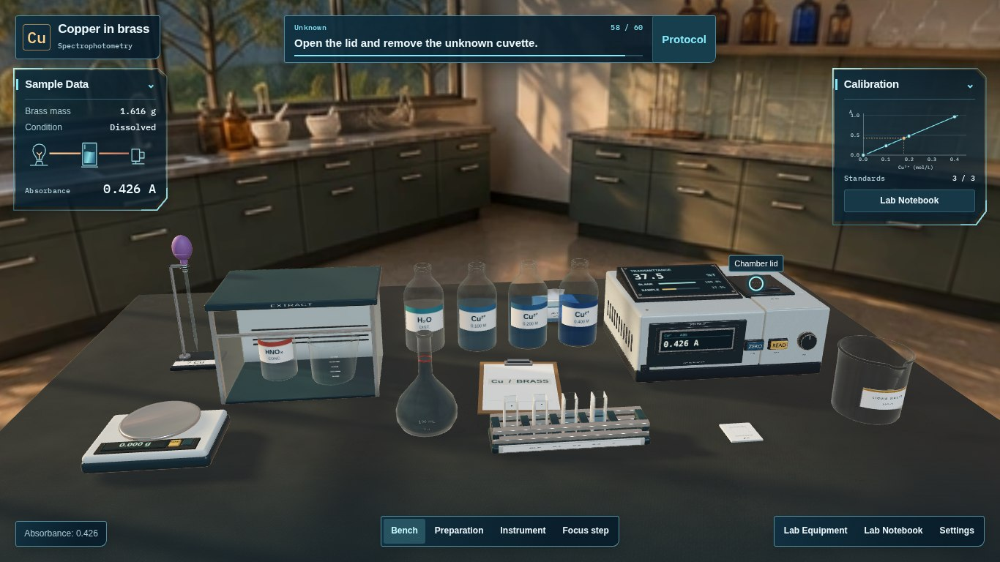

# Copper in Brass · 3D

Determine the mass percent of copper in a brass sample by weighing it, preparing a 100 mL solution, blanking the spectrophotometer, and measuring three copper standards and an unknown. The notebook records the balance and instrument readings, plots absorbance against concentration, checks the final answer, and exports a CSV.

## Run the lab

From the **repository root**, run `python -m http.server 8000` and open [Copper in Brass 3D](http://localhost:8000/experiments/copperinbrass_v2/). The page uses WebGL 2. Serving the repository root makes both sibling experiments available. All runtime assets ship with the repository.

- Click or tap an item to set it out. For a transfer, drag the tool onto the indicated target or select the two in sequence. Open **Equipment** for the same actions with a keyboard.
- Drag open bench space to orbit. Scroll or pinch to zoom. Shift-drag or use two fingers to pan. **Focus step** frames the apparatus for the current action. **Follow current step** starts enabled on phones.
- Open **Lab Notebook** for readings, cleanup and calculation. **Settings** includes ten-step undo, restart, English, Azerbaijani, Turkish and German, the three reference bench finishes, and optional local webcam controls. With hand control enabled, point with the index finger and pinch to select or drag. Camera modes require HTTPS or localhost.

## Experiment model

The 60-step sequence, equipment assignments, mass range, dilution volume, molar mass and grading tolerance follow the [2D experiment](../copperinbrass/). Each run uses a new 1.300–1.700 g sample. The dissolved sample and its rinses undergo quantitative transfer to the volumetric flask. Making up to volume represents bulk water addition, final drops and mixing in one guided action. The simulated dissolution is time-compressed.

The worksheet specifies **A = 2.426c − 0.00538**, where c is in mol/L. The 2D standard lookup table disagrees with that equation. This edition generates the 0.100, 0.200 and 0.400 mol/L standards and the unknown from the same worksheet line, with a small run-specific variation. The water blank reads 0.000 A. It is excluded from the regression through the measured standards. The notebook uses the displayed unknown absorbance and brass mass for grading, with a tolerance of ±2 percentage points. The source procedure specifies a fixed method without a numerical wavelength.

A fresh cuvette is issued for each sample. Each standard receives a clean transfer pipette. Liquid color, menisci, brass dissolution and optical displays respond to the experiment state. The marked 100 mL fill and fixed-method instrument readings are instructional simulations.

## Shared scene and editable apparatus

The worktop, cabinets, panoramic rooms, reflection textures, lighting, spectrophotometer, cuvettes, pipette and rendering code load directly from [Spectrophotometry Studio v2](../spectrophotometry_v2/). The copper experiment supplies its own specimen, vessels, balance, extraction hood, rack, labels, controls and notebook.

[Editable Blender apparatus](authoring/apparatus.blend) · [Blender authoring script](authoring/apparatus.py) · [Editable optical-path SVG](assets/optical-path.svg)

The Blender file includes an overview camera and a reverse inspection camera. From this folder, `blender -b --factory-startup --python authoring/apparatus.py` regenerates both the Blender file and the indexed mesh pack in `assets/`.

## Verification

Run `npm test` from this folder for protocol, calibration, grading and undo checks. With Python Playwright and Chromium installed, `python tests/browser_flow.py` serves the repository locally and completes a run using the rendered controls. Set `CHROMIUM_PATH` to use an existing browser executable.
